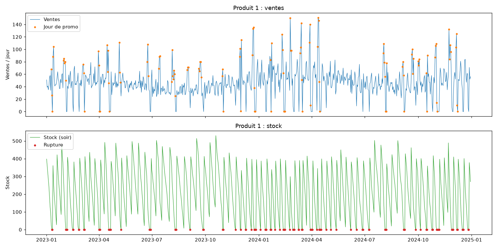
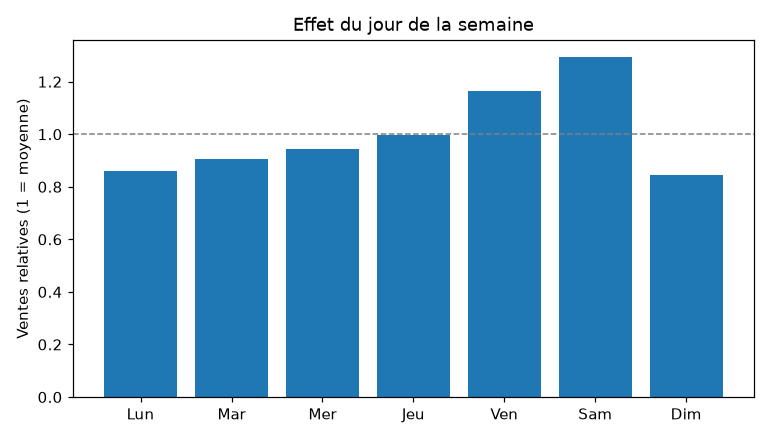
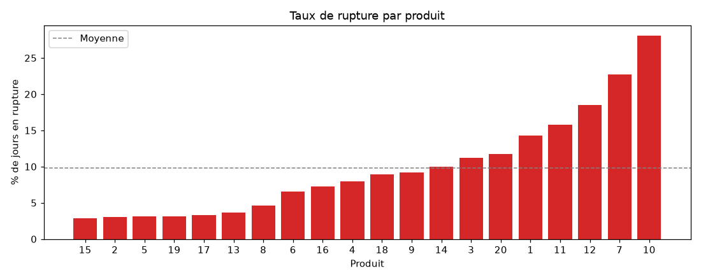
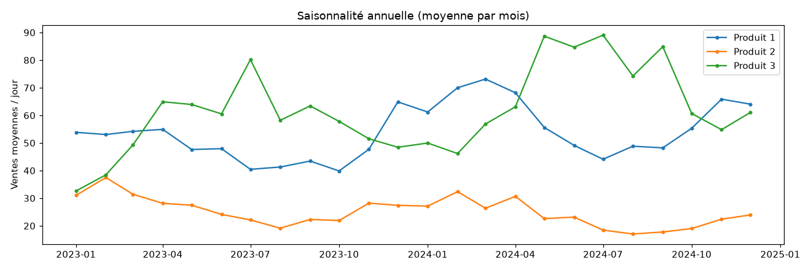

# Prévision des ventes et alertes de rupture de stock

Projet de Machine Learning de bout en bout : prévoir les ventes des 7 prochains jours pour chaque produit, et estimer la probabilité de tomber en rupture de stock pendant cette période.

> 🚧 **Projet en cours.** La simulation et l'exploration des données sont terminées. La modélisation, l'API et l'interface web arrivent dans les prochaines étapes (voir [Avancement](#avancement)).

**Stack** : Python · pandas · NumPy · Matplotlib · scikit-learn · XGBoost · SHAP · FastAPI · Docker

---

## Le problème

Un magasin doit commander ses produits **avant** de les vendre. S'il commande trop tard, le produit n'est plus disponible : c'est une **rupture de stock**. Le client part et la vente est perdue.

Le projet répond à deux questions, chaque soir et pour chaque produit :

| Question | Type de problème | Sortie |
|---|---|---|
| Combien vais-je vendre dans les 7 prochains jours ? | Régression | un nombre d'unités |
| Vais-je tomber en rupture dans les 7 prochains jours ? | Classification | une probabilité |

## Les données

Les données sont **simulées** par [`src/simulate.py`](src/simulate.py). L'objectif est de montrer toute la démarche ML, pas de modéliser un vrai commerce.

- **20 produits**, ventes quotidiennes sur **2 ans** (2023-2024), soit 14 600 lignes
- La demande combine une **tendance**, une **saisonnalité hebdomadaire et annuelle**, des **promotions** et un bruit de Poisson
- Le **stock** est simulé jour par jour : réception des livraisons, ventes limitées par le stock disponible, commande quand le stock passe sous un seuil, délai de livraison aléatoire
- Le seuil de commande varie d'un produit à l'autre, donc certains produits tombent souvent en rupture et d'autres presque jamais

| Colonne | Description |
|---|---|
| `date`, `product_id` | jour et produit |
| `promo` | 1 si le produit est en promotion ce jour-là |
| `stock_start`, `stock_end` | stock le matin (après livraison) et le soir |
| `received` | quantité livrée ce jour-là |
| `sales` | unités vendues (limitées par le stock) |

## Exploration des données

[`src/explore.py`](src/explore.py) vérifie que les données contiennent bien les effets attendus.

**Ventes et stock d'un produit** : les promotions (en orange) font monter les ventes, et le stock suit un cycle en « dents de scie ». Les ruptures (en rouge) arrivent souvent juste après une promotion.



| Effet du jour de la semaine | Taux de rupture par produit |
|---|---|
|  |  |



Ce qu'on observe :
- **9,8 %** des jours sont en rupture en moyenne, de 2,9 % à 28,1 % selon le produit. Les ruptures sont donc une classe minoritaire, et l'accuracy seule ne suffira pas pour évaluer le classifieur.
- Les ventes moyennes passent de **27** unités par jour sans promotion à **47** avec promotion (+70 %).
- Le samedi est le jour le plus fort (×1,29), le dimanche et le lundi les plus faibles (×0,85).
- **Ventes ≠ demande** : un jour de rupture, les ventes sont limitées par le stock et ne montrent pas la vraie demande. Ces jours sont exclus quand on mesure les effets de saisonnalité.

## Avancement

- [x] Environnement et dépendances
- [x] Simulation des données
- [x] Exploration des données
- [ ] Feature engineering : lags, moyennes glissantes, jours de stock restants, promotions prévues (sans fuite de données)
- [ ] Modèles : baseline, Random Forest, XGBoost, validation temporelle avec `TimeSeriesSplit`
- [ ] Évaluation : MAE / RMSE pour la régression, précision / rappel / PR-AUC pour la classification
- [ ] Explicabilité avec SHAP
- [ ] API FastAPI (`/predict`, `/alerts`, `/health`)
- [ ] Interface web : tableau des alertes et courbe de prévision
- [ ] Tests (pytest) et image Docker

## Lancer le projet

Testé avec Python 3.14 sur Ubuntu.

```bash
git clone git@github.com:houssam-b/stock-forecast.git
cd stock-forecast

python3 -m venv .venv
source .venv/bin/activate
pip install -r requirements.txt

python -m src.simulate   # génère data/sales.csv
python -m src.explore    # génère les graphiques dans reports/figures/
```

## Structure

```
├── data/              # données générées (non versionnées)
├── reports/figures/   # graphiques d'exploration
├── src/
│   ├── simulate.py    # simulation des ventes et du stock
│   └── explore.py     # exploration et graphiques
├── tests/
└── requirements.txt
```

## Auteur

Houssam Eddine BAHHOUS · [github.com/houssam-b](https://github.com/houssam-b)
